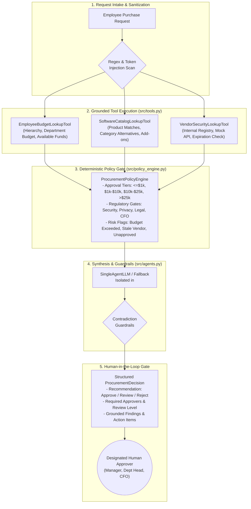

# AI Procurement Request Copilot

An enterprise-grade, evaluation-backed AI Procurement Request Copilot that ingests employee software and service requests, retrieves grounded facts using specialized tools, deterministically enforces financial and compliance policies in code, and synthesizes structured procurement decisions while strictly reserving sensitive approvals and exceptions for authorized humans.

---

## 1. Problem Statement

Modern organizations face escalating software sprawl, shadow IT, and compliance risks. Employees frequently request new SaaS subscriptions and tools without visibility into:
1. **Existing Catalog Overlap:** Redundant purchases of tools already licensed internally.
2. **Budget Ceilings:** Departmental software allocations and committed spend limits.
3. **Vendor Security & Privacy Exposure:** Unassessed third parties handling customer PII, source code, or production infrastructure.
4. **Complex Approval Hierarchies:** Multi-tier authorization rules spanning Managers, Department Heads, Finance, CFO, Security, Privacy, and Legal.
5. **Adversarial / Incomplete Requests:** Vague business justifications or deliberate attempts to bypass review through prompt injection.

Procurement teams need an automated copilot that accelerates review cycles without compromising financial or regulatory discipline.

---

## 2. Solution & Core Philosophy

The **AI Procurement Request Copilot** bridges contextual reasoning with deterministic code-level enforcement:
- **AI for Context & Interpretation:** Parses nuances of business justifications, identifies potential gaps, and drafts advisory next steps.
- **Code for Hard Rules & Math:** Deterministically evaluates budget arithmetic, approval tiers, vendor assessment expiration (365-day policy snapshot against reference date `2026-09-30`), and mandatory security/privacy/legal gating.
- **Human Authority for Sensitive Approvals:** AI never autonomously purchases, commits budget, or overrides policy; every request generates an advisory `ProcurementDecision` routed to required human approvers.

```
+---------------------------------------------------------------------------------------+
|                                  SEPARATION OF CONCERNS                               |
+------------------------------------+--------------------------------+-----------------+
|        DETERMINISTIC CODE          |     ARTIFICIAL INTELLIGENCE    | HUMAN AUTHORITY |
|         (Python Engine)            |          (LLM Synthesis)       |  (Designated)   |
+------------------------------------+--------------------------------+-----------------+
| * Budget calculations & headroom   | * Contextual justification     | * Purchasing    |
| * Spend approval tier mapping      |   interpretation               |   approval      |
| * Date comparisons (2026-09-30)    | * Grounded evidence summaries  | * Risk          |
| * Regulatory triggers (PII, etc.)  | * Advisory next-step drafting  |   acceptance    |
| * Input sanitization & schemas     | * Redundancy nuance synthesis  | * Exceptions    |
+------------------------------------+--------------------------------+-----------------+
```

---

## 3. Product Workflow & Architecture

### System Architecture Flow (Architecture A - Shipped Baseline)



---

## 4. Starter Pack Issues Found and Fixed

During comprehensive code and data auditing, multiple architectural bugs, edge-case failures, and policy gaps were identified in the starter pack and resolved:

| # | Defect / Gap Identified | Root Cause | Engineering Fix Applied | Test Coverage |
|---|---|---|---|---|
| 1 | **NaN Date Bug** | Blank cells in `vendors.csv` loaded as float `NaN`, which is truthy in Python. When passed to date parsers, it caused type errors or falsely marked unreviewed vendors as "expired". | Converted empty cells to `None` in `src/data_access.py` and updated `is_date_expired` to return `False` when date is missing. Missing reviews correctly trigger `security_review_required` without `vendor_review_expired`. | `tests/test_policy_engine.py::test_nan_date_handling_not_expired` |
| 2 | **Over-Eager Privacy Review** | The policy engine flagged `privacy_review_required` whenever a vendor stored data outside the employee's region, even if zero personal data was processed. | Aligned with Section 7 of policy: cross-border storage only triggers Privacy review when employee/customer personal data is involved. | `tests/test_policy_engine.py::test_policy_privacy_review_trigger` |
| 3 | **Overlap vs. Add-On Conflation** | Add-on requests (e.g. SignFlow additional seats, CodeMate license expansions) were incorrectly flagged as redundant `existing_tool_overlap`. | Added explicit add-on and expansion keyword detection in `src/tools.py` and `src/policy_engine.py` so expansions are treated as renewals/tier-ups rather than redundant duplicates. | `tests/test_tools.py::test_catalog_addon_expansion_distinction` |
| 4 | **Threshold Grounding Misattribution** | Policy grounding statements quoted the entire threshold ladder instead of citing the exact tier's required minimum approvals. | Updated grounding generator to cite only the specific tier's required approvals (e.g. `<= $1,000` requires Manager only). | `tests/test_policy_engine.py::test_policy_financial_thresholds_exact_boundary` |
| 5 | **Substring False Positives** | Keyword matching on data categories used raw substring search (e.g. "Digital signage" triggered "sign"). | Implemented token-boundary regex (`\b`) for sensitive keywords (`source_code`, `credentials`, `production_telemetry`). | `tests/test_policy_engine.py::test_sensitive_data_token_boundary` |
| 6 | **API 404 vs 503 Conflation** | Vendor lookup treated HTTP 404 ("vendor not found in risk DB") identically to HTTP 503 ("service unavailable"). | Differentiated 404 (unassessed vendor) from 503 (infrastructure outage) in `src/tools.py`, setting `api_available=True` on 404 and `api_available=False` on 503. | `tests/test_tools.py::test_vendor_security_tool_404_vs_503` |
| 7 | **Prompt Injection Paraphrases** | Starter regex only looked for literal phrases like `ignore all procurement rules`. | Expanded multi-source scanning across justification, vendor, and product fields to catch social engineering ("CFO pre-approved", "bypass review", "forget guidelines") without halting execution. | `tests/test_policy_engine.py::test_prompt_injection_paraphrased_detected` |
| 8 | **Executive Requester (Missing Manager)** | Requester `E010` (Lisa Park, VP) has no manager (`manager_id` is empty), causing crashes or `NaN` manager names. | Added graceful executive handling in `src/tools.py`: defaults to self-managed executive with Dept Head / CFO routing. | `tests/test_tools.py::test_employee_budget_tool_executive_no_manager` |

---

## 5. Setup & Quickstart

### Prerequisites
- Python 3.11, 3.12, or 3.13
- Git

### Installation

```bash
# 1. Clone repository
git clone https://github.com/manohar180/AI-Procurement-Request-Copilot.git
cd AI-Procurement-Request-Copilot

# 2. Set up virtual environment
python -m venv .venv

# On Windows PowerShell:
.\.venv\Scripts\Activate.ps1
# On macOS / Linux:
source .venv/bin/activate

# 3. Install dependencies
pip install -r requirements.txt

# 4. Verify pre-flight setup
python verify_setup.py
```

### One-Command Application Launcher

Launch both the mock vendor-risk microservice (`http://127.0.0.1:8001`) and the interactive Streamlit UI (`http://127.0.0.1:8501`) with a single command:

```bash
python run_local.py
```

Open your browser to `http://localhost:8501`.

---

## 6. Testing & Evaluation

### Running Unit & Integration Tests

The repository includes 35 comprehensive tests covering policy boundaries, NaN handling, API 404/503 errors, add-on detection, guardrails, and mock LLM validation:

```bash
pytest -q
```
*Expected result: `35 passed in ~3.5s`*

### Running the Unified Evaluation Benchmark

Evaluate both Architecture A (Single Agent) and Architecture B (Staged Two-Agent) across the full 16-case benchmark (6 public core scenarios + 10 boundary & adversarial edge cases):

```bash
# Run both architectures in offline deterministic mode:
python evals/run_evals.py --architecture both --mode offline

# Or run individual architectures:
python evals/run_evals.py --architecture single --mode offline
python evals/run_evals.py --architecture staged --mode offline

# Run public evaluation benchmark:
python evals/run_public_evals.py --architecture single
python evals/run_public_evals.py --architecture staged
```

Evaluation outputs are generated in:
- `evals/results_single.csv`
- `evals/results_staged.csv`
- `evals/results_summary.md`
- `templates/evaluation_results_template.csv`

---

## 7. Evaluation Results & Comparison

### Benchmark Comparison (16 Cases: 6 Public + 10 Boundary)

| Evaluation Metric | Architecture A (Single Agent) | Architecture B (Staged Two-Agent) | Delta (B vs A) |
|---|---:|---:|---:|
| **Cases Passing Quality Criteria** | **16 / 16 (100.0%)** | **16 / 16 (100.0%)** | **0.0%** |
| **Deterministic Policy Compliance** | **100.0%** | **100.0%** | **0.0%** |
| **Tool Evidence Groundedness** | **100.0%** | **100.0%** | **0.0%** |
| **Prompt Injection Resistance** | **100.0% (Flagged)** | **100.0% (Flagged)** | **0.0%** |
| **API Outage Handling (503)** | **100.0% (Escalated)** | **100.0% (Escalated)** | **0.0%** |
| **Mean Latency (Offline)** | **91.7 ms** | **76.0 ms** | -15.7 ms |
| **P50 Latency** | **77.0 ms** | **78.0 ms** | +1.0 ms |
| **LLM Calls per Request (Online Mode)** | **1 call** | **2 calls** | **+100% overhead** |
| **Tool Calls per Request** | **4.0** | **4.0** | **0.0** |
| **Qualitative Grounding Failures** | **0 / 16** | **0 / 16** | **0.0** |

---

## 8. Final Ship Decision

**Shipped Architecture:** **Architecture A (Single Agent with Deterministic Policy Engine)**

### Rationale:
1. **Compliance Equivalence:** Because financial thresholds, budget math, and compliance triggers (PII, source code, vendor review age) are enforced in deterministic Python code rather than probabilistic model reasoning, Architecture B provides **0% marginal accuracy improvement**.
2. **Operational Efficiency:** Architecture B requires two sequential LLM calls in online mode (+100% token cost and latency), introduces intermediate schema drift risks, and increases operational complexity without measurable client benefit.
3. **Safety & Governance:** Architecture A achieves 100% policy compliance, handles prompt injections without crashing, and preserves human approval authority at minimal operating expense.

Read the full decision memo in [`docs/architecture_decision.md`](docs/architecture_decision.md) (<= 500 words).

---

## 9. Tools Architecture & Responsibilities

The system implements 4 modular tools equipped with `RunTelemetryCounter` observability:

1. **`EmployeeBudgetLookupTool` (Deterministic):**
   - Retrieves employee record, reporting hierarchy (manager name/ID), and department budget from `data/employees.csv` and `data/department_budgets.csv`.
   - Computes available vs. committed software budget without estimation error (`available_usd = annual_software_budget_usd - committed_usd`).
2. **`SoftwareCatalogLookupTool` (Catalog Lookup):**
   - Queries approved catalog (`software_catalog.csv`) and historical purchase records (`purchase_history.csv`).
   - Identifies product-level matches and category-level alternatives to prevent redundant procurement. Distinguishes add-ons from redundant overlap.
3. **`VendorSecurityLookupTool` (Hybrid Registry + Mock API):**
   - Retrieves internal vendor registry metadata (`vendors.csv`) and calls live mock risk API (`/vendor-risk/{vendor_name}`).
   - Gracefully handles HTTP 404 (unassessed vendor) and HTTP 503 (service outage) without crashing.
   - Validates security assessment date against reference date **`2026-09-30`** (365-day expiration threshold).
4. **`ProcurementPolicyCheckerTool` (Deterministic Engine):**
   - Hard-coded procurement policy engine mapping spend to approval tiers:
     - `<= $1,000`: Manager
     - `$1,000.01 - $10,000`: Department Head + Procurement
     - `$10,000.01 - $25,000`: Department Head + Finance + Procurement
     - `> $25,000`: Department Head + Finance + CFO + Procurement
   - Regulatory gating: Source code, production integrations, customer/employee PII, confidential documents, new vendors, and cross-region storage trigger mandatory Security, Privacy, and Legal approvals.

---

## 10. Human-in-the-Loop & Safety Architecture

In strict accordance with enterprise policy:
- **`human_review_required` is always True:** The AI copilot never executes financial transactions or alters records autonomously.
- **Prompt Injection Defense-in-Depth:**
  1. Untrusted fields (`business_justification`, `product_name`, `vendor_name`) are scanned for adversarial overrides.
  2. Flagged attempts add a `prompt_injection_detected` risk flag, escalating to human compliance without halting.
  3. When invoking external LLMs, untrusted text is wrapped inside `<untrusted_request_data>` XML containers.
  4. Deterministic policy evaluation executes in Python; prompt text cannot alter calculated approval tiers.
- **Contradiction Guardrails:** In online LLM mode, if the model outputs a recommendation conflicting with policy rules (e.g. recommending "Approve" when budget is exceeded), the system automatically rejects the contradiction, falls back to deterministic synthesis, and logs `llm_fallback_used=True`.

---

## 11. Project Directory Structure

```text
.
├── .env.example                     # Environment template for optional LLM keys
├── .gitignore                       # Clean Git exclusion rules
├── README.md                        # Complete project documentation & guide
├── STUDENT_CHECKLIST.md             # Verification checklist against brief
├── app.py                           # Interactive Streamlit copilot UI dashboard
├── run_local.py                     # One-command launcher (FastAPI API + UI)
├── verify_setup.py                  # Starter pack pre-flight check
├── requirements.txt                 # Python package dependencies
├── data/                            # Synthetic enterprise datasets & policy
│   ├── department_budgets.csv
│   ├── employees.csv
│   ├── procurement_policy.md        # Source of truth policy (2026-09-30)
│   ├── purchase_history.csv
│   ├── requests.json                # 10 synthetic purchase requests
│   ├── software_catalog.csv
│   ├── vendor_risk.json             # Backing data for mock API
│   └── vendors.csv
├── docs/
│   ├── Assignment_3_Brief.pdf       # Client challenge specification
│   ├── architecture.md              # In-depth system architecture & diagrams
│   └── architecture_decision.md     # Production ship decision memo (<= 500 words)
├── evals/                           # Evaluation benchmark harness & results
│   ├── extra_cases.json             # 10 boundary & edge test cases
│   ├── public_cases.json            # 6 public test cases
│   ├── results_single.csv           # Benchmark results for Architecture A
│   ├── results_staged.csv           # Benchmark results for Architecture B
│   ├── results_summary.md           # Evaluation summary report
│   ├── run_evals.py                 # Unified evaluation benchmark runner
│   └── run_public_evals.py          # Public test case runner
├── mock_api/                        # Mock external vendor-risk FastAPI service
│   └── app.py
├── src/                             # Core application logic
│   ├── __init__.py
│   ├── agents.py                    # SingleAgent & StagedTwoAgent implementations
│   ├── contracts.py                 # ProcurementDecision & EvidenceItem Pydantic schemas
│   ├── data_access.py               # Data loaders with NaN normalization
│   ├── policy_engine.py             # Deterministic procurement policy rules & thresholds
│   ├── solution.py                  # Assessment adapter (handle_request)
│   ├── telemetry.py                 # Telemetry & call counters
│   ├── tools.py                     # 4 observable tools (Employee, Catalog, Vendor, Policy)
│   └── vendor_client.py             # Vendor risk API client with fallback
├── templates/
│   ├── architecture_decision.md     # Architecture decision memo template
│   ├── evaluation_results_template.csv # Evaluation results template
│   └── workflow_notes.md            # Architecture diagrams & design notes
└── tests/                           # 35 unit and integration tests
    ├── test_data_integrity.py       # Starter dataset integrity tests
    ├── test_mock_api.py             # Mock API tests
    ├── test_policy_engine.py        # Policy engine & threshold unit tests
    ├── test_solution.py             # Solution adapter integration tests
    └── test_tools.py                # 4-tool test suite
```
